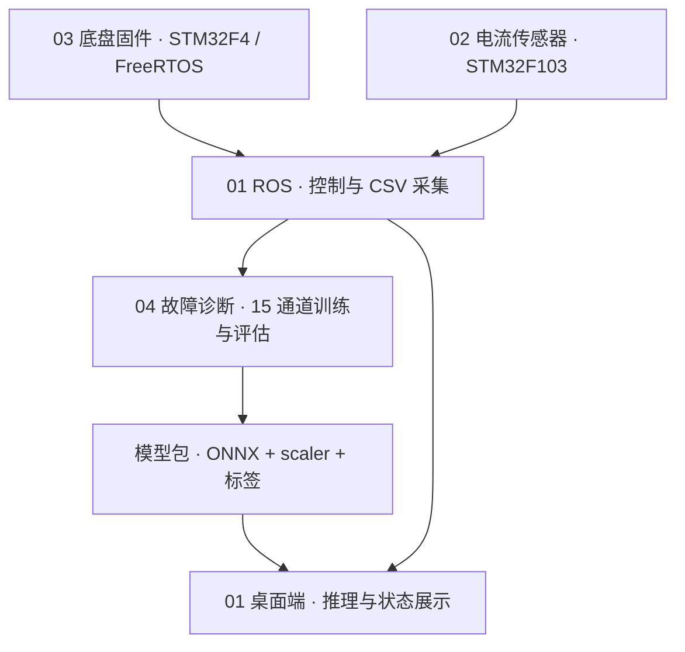

# 多传感器机器人故障诊断

**杨鹏（Yang Peng）· 燕山大学本科毕业设计**

围绕 WHEELTEC R550PLUS 三全向轮机器人，研究如何从运动、电流和 IMU 时序信号中识别**正常、车轮打滑、驱动异常、轴偏心**四种状态。项目将传感器采集、ROS 控制、离线模型实验与桌面推理连接起来，模型输入为 **15 通道 × 50 点时间窗口**。

这是同一机器人项目的**研究与完整工程入口**；配套的 [wheeltec-robot-platform](https://github.com/y-gougou/wheeltec-robot-platform) 是持续维护的 ROS/Web/Electron 应用入口。

[完整技术说明](docs/project-guide.md) · [训练与实验代码](04%20last%20dance/last%20dance/ypmodel/run_experiments.py) · [原始数据](04%20last%20dance/last%20dance/shuju0517/) · [部署与已知限制](#部署与已知限制)

## 项目工作

- **传感器与机器人链路：** 保留电流板固件、上位机及标定工具，结合底盘串口、里程计、轮速与 IMU，在 ROS 中采集并记录 CSV；采集实现见 [data_collector.py](01_ROS/turn_on_wheeltec_robot/scripts/data_collector.py)。
- **故障诊断实验：** 以里程计速度 3、轮速 3、IMU 6、电流 3 共 15 个特征构造滑动窗口，保存 SAGE-CNN、消融变体与 CNN/MLP/LSTM/BiLSTM 等对比实验；包括主工况、跨速度泛化与部署鲁棒性三个实验流程。
- **推理衔接：** 保存 ONNX/PT、scaler、标签与特征配置，并提供桌面推理接口、回放和后处理代码。研究结果与部署选择分别记录，便于追溯使用的模型版本。

## 系统与四个子模块

- [01_ROS](01_ROS/turn_on_wheeltec_robot/README.md)：底盘通信、采集、Web/Electron 与推理接口。
- [02 4CH-Current](02%204CH-Current/)：电流板固件、Python 上位机、ROS 驱动和标定工具。
- [03 omi_car](03%20omi_car/README.md)：底盘控制、FreeRTOS、电机 PID、IMU 和通信。
- [04 last dance](04%20last%20dance/last%20dance/)：原始 CSV、模型、实验结果及导出文件。

## 已保存的实验结果

以下是**仓库保存的历史离线结果**，不是本次重新训练所得。主表仅覆盖 `vx=0.5` 的 **50 个 CSV**；完整原始数据共 66 个 CSV，另外 `vx=0.3`、`vx=0.7` 各 8 个文件不计入此表。

每模型 5 轮，按故障类别进行 **CSV 文件级分层划分**，实际每轮训练/验证/测试为 **34/6/10 个文件**（目标比例 70/10/20 经逐类取整）。窗口长度 50、步长 10；训练集拟合标准化参数；每轮训练 4,403–4,553 个窗口，测试 1,143–1,351 个窗口。表中为 **均值 ± 总体标准差（ddof=0）**。

| 模型 · 主工况 vx=0.5 | Accuracy | Macro F1 |
|---|---:|---:|
| `sage_cnn`（完整模型） | 0.9803 ± 0.0054 | 0.9647 ± 0.0096 |
| `sage_no_saf`（去 SAF 变体） | 0.9807 ± 0.0096 | 0.9646 ± 0.0193 |

来源：[汇总表](04%20last%20dance/last%20dance/ypmodel/results_final_summary/tables/table_main_model_comparison.csv)、[逐轮指标](04%20last%20dance/last%20dance/ypmodel/results_paper_main_vx05/summaries/all_runs.csv)、[划分与窗口计数示例](04%20last%20dance/last%20dance/ypmodel/results_paper_main_vx05/checkpoints/sage_cnn/run_01/dataset_check_report.csv)、[划分及统计实现](04%20last%20dance/last%20dance/ypmodel/run_experiments.py)。两模型在此主工况的 Macro F1 接近；这些窗口来自同一采集数据池，类别不平衡，重叠窗口数量不等于独立实车试验次数，也不代表跨设备、跨场景性能。

*历史图：9 种模型或变体，每种 5 轮；柱为 Macro F1 均值，误差线为总体标准差。图表沿用仓库已有结果，未在本次文档整理中重新生成。*

## 部署与已知限制

- **模型变体需区分。** 当前研究导出配置选择 `sage_no_saf / run_03`，依据是该变体各轮中的验证集 Macro F1；它与上表完整 `sage_cnn` 的统计口径不同。[导出配置](04%20last%20dance/last%20dance/ypmodel/results_deployment_robust/export/inference_config.json) 与 [桌面默认入口](01_ROS/turn_on_wheeltec_robot/desktop/inference-service.js) 可核查。桌面同时保留两套模型目录，默认指向 `sage_no_saf`，有效的自定义 manifest 可覆盖默认选择。
- **标签与协议有历史差异。** 部署标签为 `0 normal / 1 wheel_slip / 2 drive_abnormal / 3 shaft_eccentricity`，旧采集文档的 1/2 编号不同。电流板当前默认 FireWater 文本协议，而独立 HostApp/ROS 驱动使用二进制解析，连接前需统一协议、字段与校验。
- **复现需要配套版本。** 权重、特征顺序、scaler、标签和后处理配置应配套使用；本仓库 ROS 快照与维护平台有代码差异，同名 ROS 包不能同时放入一个 catkin 工作空间。部分旧实验总结中的默认模型描述已过时。

详细命令、协议差异、模型配置、历史分支和资源说明均保存在 [完整技术说明](docs/project-guide.md)。本次仅核对并调整文档，未重训、重新编译、烧录或完成新的实车验证。

作者：杨鹏（Yang Peng）。项目基于 WHEELTEC 机器人及相关开源组件开展集成与研究，保留各子项目、WHEELTEC、STM32/HAL、FreeRTOS 及其他第三方组件原有作者与许可证信息；本总览不替各组件重新指定许可证。
